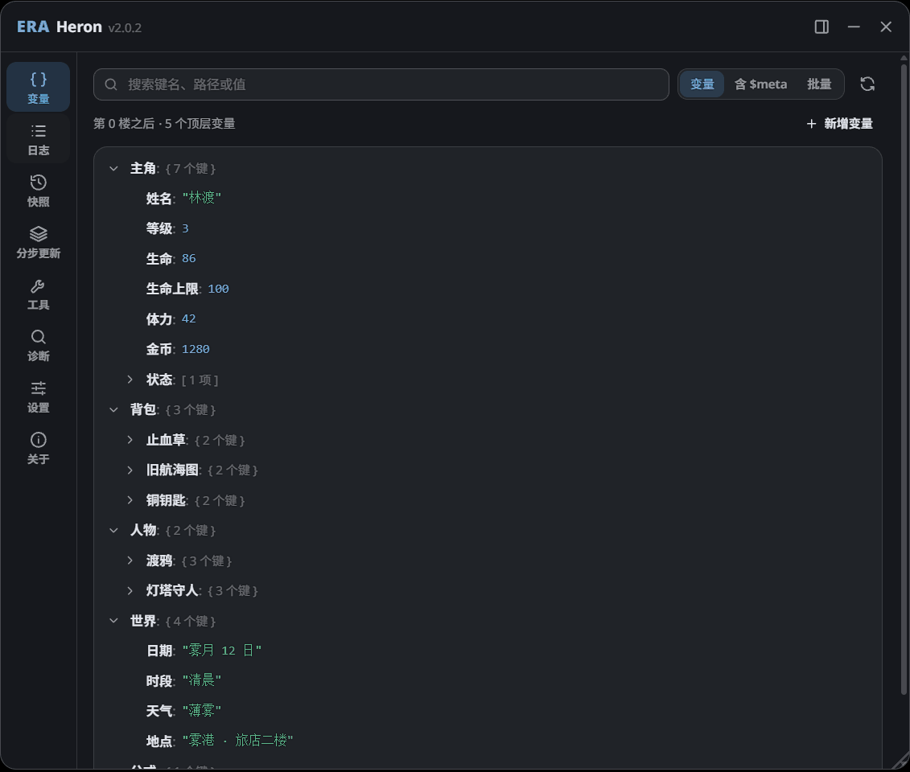
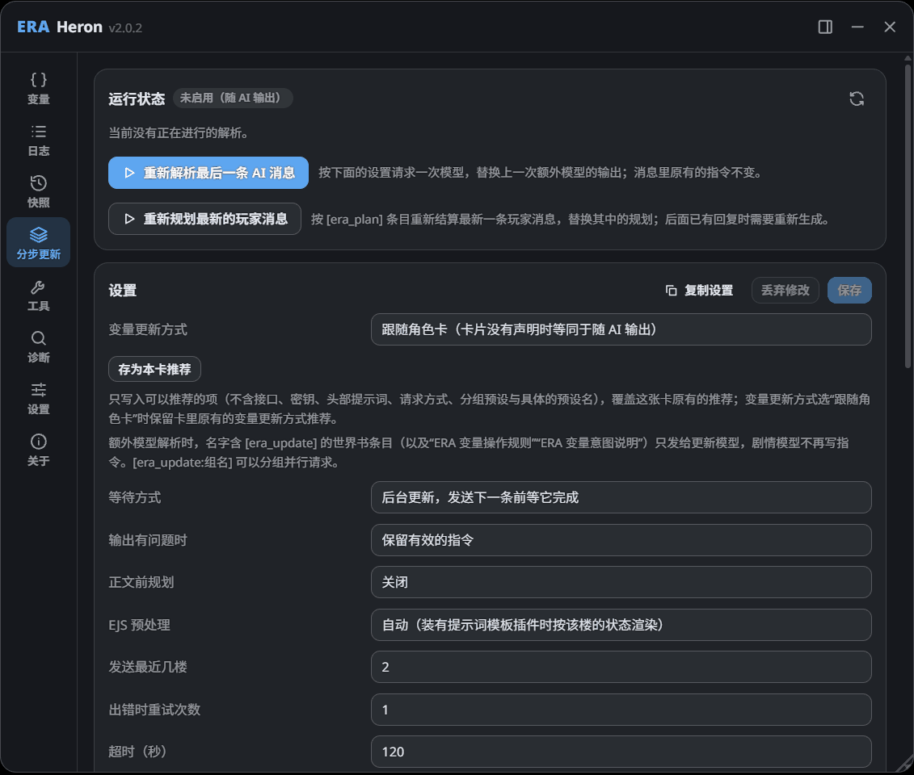
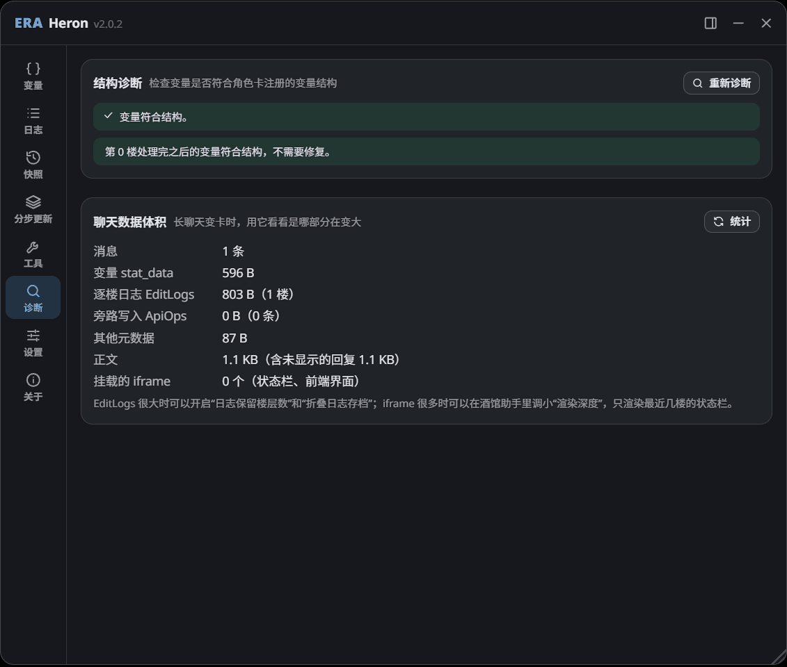
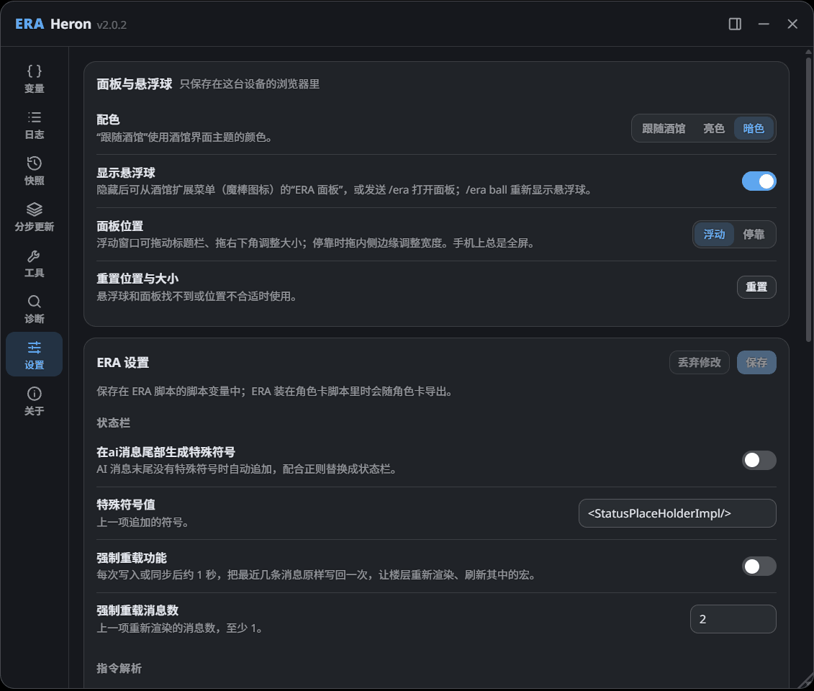
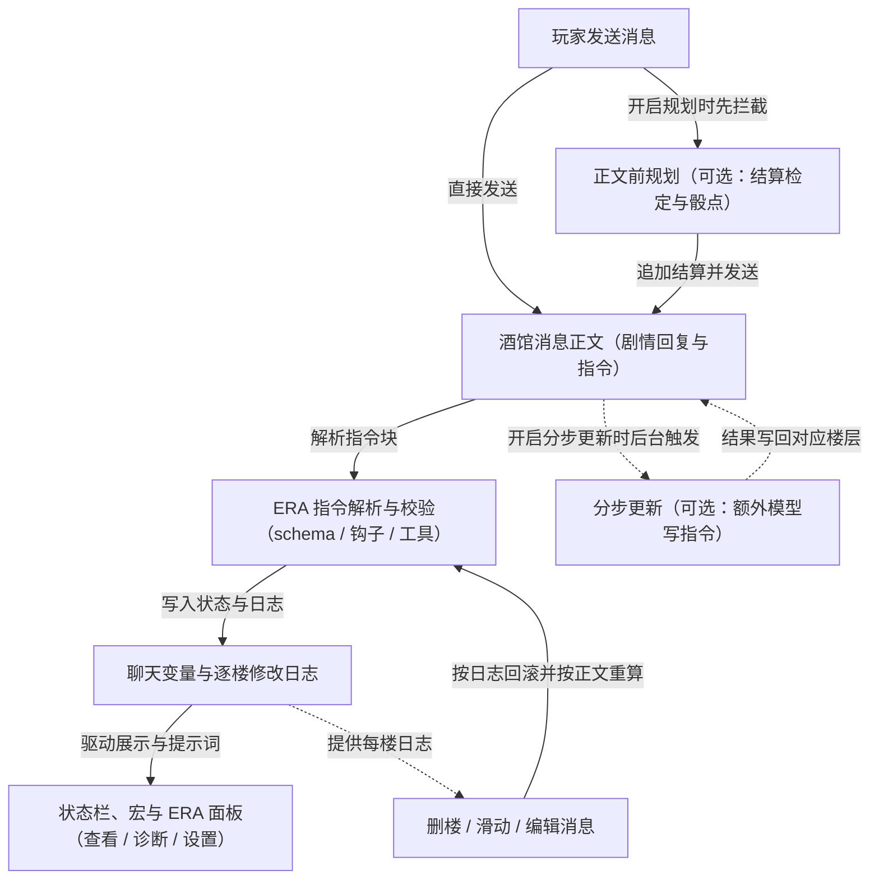

<p align="center">
  
</p>

# ERA-Heron · 基于 ERA 变量框架二次开发

ERA（Efficient Rollback Architecture）是一个 [酒馆助手（Tavern Helper）](https://github.com/N0VI028/JS-Slash-Runner) 脚本，用来给 SillyTavern 角色卡管理变量：AI 在回复里写变量指令，ERA 负责更新；删除、滑动（swipe）、编辑消息时，变量会自动回到与当前聊天记录一致的状态。

**ERA-Heron** 是基于 ERA 变量框架二次开发、持续迭代的酒馆助手变量框架；原作者为 [RockingSisyphus（世界的山田）](https://github.com/RockingSisyphus/ERA-EfficientRollbackArchitecture)（原版已转向新架构、不再更新）。ERA-Heron 在原框架上加入了变量结构校验、`<VariablePatch>`、`$expr` 表达式、工具调用、分步更新、正文前规划与全新工作台面板，并且**兼容现有的 ERA 角色卡和聊天记录**。

当前版本：**2.0.7** · [更新日志](更新日志.md) · 许可：[AFPL](LICENSE)（免费使用，不得收费分发）

**示例卡**：[ERA-Heron示例卡](https://github.com/Bailuci/ERA-Heron-Example)，一张简易的VIBE制作的RPG同层前端卡，ERA 的主要能力都对应一处玩法，附拆卡指南和 ERA 制卡规范。[直接下载卡](https://github.com/Bailuci/ERA-Heron-Example/releases/latest/download/ERA-Heron-Example.png)。

---

## 界面预览

点击屏幕边缘的 ERA 悬浮球即可打开工作台面板（悬浮球可拖动贴边；隐藏后可从酒馆扩展菜单的“ERA 面板”或发送 `/era` 打开）：

| 变量工作台 | 分步更新与正文前规划 |
| :---: | :---: |
|  |  |
| 结构诊断与聊天数据体积 | 面板与脚本设置 |
|  |  |

---

## 能做什么

**核心回滚机制**

- 变量保存在当前聊天的聊天变量里，每条消息只记录一个“消息密钥”作为锚点；删除、滑动、编辑消息时按逐楼日志回滚并按正文重算，变量与看到的聊天记录始终一致。
- 修复原版的若干回滚与同步错误，详见 [更新日志](更新日志.md)。

**变量指令与公式计算**

- AI 用 JSON 写变量指令：只增不改的 `<VariableInsert>`、只改不增的 `<VariableEdit>`、`<VariableDelete>`，以及支持数组增删、整体替换、改名移动与“有则改无则插”的 `<VariablePatch>`。
- 支持数字增量（`"+=5"`、`"-=3"`）、`$meta` 保护（禁改、禁删、禁插）、`$template` 新条目模板和 `_` 开头只读字段。
- 支持表达式 `$expr`（按公式计算数字、掷骰并保证重算时骰点不变；跨浏览器确定性数学库 `Era.math`）、存成普通变量的公式 `call(公式路径, 参数…)`，以及让 AI 调用角色卡脚本按规则结算的工具调用 `<EraFCall>` 和自定义公式函数。
- 自动修复 AI 写坏的 JSON（宽松解析）；新建的聊天里自动忽略思考块中的草稿指令，也支持只认指定外层标签内的指令。

**变量校验、诊断与长聊天优化**

- 可选的变量结构校验（用 zod 编写 schema，规定字段类型、范围与可选值）：通过 `{{ERA-schema}}` 告诉 AI，自动纠正格式并拦下不合法的修改。
- 面板“诊断”页支持结构诊断与一键修复旧存档、聊天数据体积统计；`{{ERA-issues}}` 可把上一轮没生效的指令原因告诉 AI；提供 `/era-get`、`/era-issues` 斜杠命令。
- 针对几百楼以上的长聊天，支持旧日志折叠与分段文件存档（写入时自动压缩并校验），在缩小聊天文件的同时仍可回滚和查看旧楼快照。

**分步更新与正文前规划**

- **分步更新**：剧情模型只写剧情，后台由另一个模型按 `[era_update]` 条目专门更新变量并写回对应楼层；支持分组并行、备用接口、出错重试、发送前等待，并可分别配置酒馆预设、头部提示词和角色信息。
- **正文前规划**：玩家发送前先由规划模型按 `[era_plan]` 条目和预掷骰子结算检定，摘要注入主生成提示词，避免“正文写赢了、数值没过检定”。

**动态提示词与脚本扩展**

- 内置 `{{ERA:路径}}`、`{{ERA:$ALLDATA}}`、`{{ERA-schema}}`、`{{ERA-issues}}`、`{{ERA-tools}}`、`{{ERA-toolResults}}`、`{{ERA-exprFns}}` 等宏；分步更新与规划中的 EJS 模板按被解析那一楼的状态渲染。
- **条目过滤器**（`Era.registerEntryFilter`）：按变量决定世界书条目发不发、发什么内容，同时作用于主生成、分步更新与正文前规划，不改写世界书文件。
- 全局接口 `Era` 与前端工具 `开发工具/era.ts`：提供等待式写入 `Era.commit`（支持原子提交与防止重复执行的幂等键 `key`）、同层前端 `Era.applyText`（不改正文的旁路写入）与 `Era.setMessageText`、试算 `Era.simulate`、每楼更新钩子与版本声明 `ERA最低版本`。

---

## 安装

1. 下载 [`artifact/bundle.js`](artifact/bundle.js)。
2. 在酒馆中打开角色卡 → 酒馆助手 → 脚本库 → **角色脚本** → 新建脚本，名字填 `ERA-Heron 2.0.7`，把 `bundle.js` 的全部内容粘贴进去并启用。

   也可以不粘贴全文，只写一行（版本号对应 [标签](https://github.com/Bailuci/ERA-Heron/tags)）：

   ```js
   import 'https://testingcf.jsdelivr.net/gh/Bailuci/ERA-Heron@v2.0.7/artifact/bundle.js';
   ```

3. 页面边缘出现 ERA 悬浮球即安装成功。点击打开 ERA 面板即可查看变量、日志、快照、分步更新、工具（快速初始化、重算、更新旧卡的规则）、诊断、设置和关于页。

### 做一张 ERA 卡的步骤

完整图文步骤见 [01 快速上手](doc/01-快速上手.md)，这里是提纲：

1. **装脚本**：按上面步骤导入 ERA，并在角色卡设置里开启局部正则。
2. **快速初始化**：面板 → 工具 →“ERA 快速初始化”，自动建好规则条目、意图说明骨架和隐藏/状态栏正则。
3. **设计变量**：集合用对象而不是数组；想清楚每个字段的类型、范围和可选值。
4. **（推荐）写变量结构**：用 zod 写 schema 并在角色卡脚本里注册，ERA 会把类型告诉 AI 并拦下错误修改。见 [示例脚本](doc/示例/变量结构与钩子脚本示例.js)。
5. **初始化**：在每个开场白末尾放一个 `<VariableInsert>`，写出全部初始变量。
6. **写意图说明**：在世界书条目 `ERA 变量意图说明` 里写清每个变量什么时候改、改多少。
7. **状态栏**：编辑局部正则 `ERA 状态栏模板`，或用前端界面显示变量。
8. **测试**：新开聊天，依次测发送、滑动、删除、编辑和“完全重算”。

### 从原版升级

1. 把角色卡上的原版 ERA 脚本内容换成本仓库的 `artifact/bundle.js`（脚本设置会保留）。
2. 打开 ERA 面板 → 工具 → **更新旧卡的规则**：备份原内容后，将规则条目和隐藏正则更新到新版并补齐缺少的隐藏正则。若提示找不到规则条目或变量宏，按 [常见问题与排错](doc/07-常见问题与排错.md#旧卡升级) 处理。
3. 旧聊天可以直接继续。新增的设置默认关闭，只有“宽松解析”默认开启；“思考标签”默认是 `think, thinking`，只对新建的聊天生效。

---

## 工作原理一览



更详细的内部模块划分、事件队列、日志存档机制与源码目录索引，见 [架构与原理说明](doc/架构与原理.md)。

---

## 文档导航

### 我想……

| 我想 | 去看 |
| --- | --- |
| 在角色卡里装上 ERA | [安装](#安装) |
| 第一次做 ERA 卡 | [01 快速上手](doc/01-快速上手.md) |
| 看一张完整的 ERA 卡怎么做 | [ERA-Heron示例卡](https://github.com/Bailuci/ERA-Heron-Example)（源码、拆卡指南、制卡规范） |
| 让 AI 帮我做 ERA 卡 | 把 [给AI的制卡流程](doc/给AI的制卡流程/SKILL.md) 发给 AI |
| 查指令、`$expr`、`call()` 和 `<EraFCall>` 怎么写 | [02 指令手册](doc/02-指令手册.md) |
| 做楼层状态栏或常驻面板 | [03 状态栏](doc/03-状态栏.md) · [04 宏](doc/04-宏.md) |
| 写前端界面、变量结构或脚本钩子 | [05 接口与设置](doc/05-接口与设置.md) · [开发工具](开发工具/) |
| 让另一个模型专门更新变量或做正文前规划 | [06 分步更新](doc/06-分步更新.md) |
| 按变量切换世界书条目 | [08 动态提示词](doc/08-动态提示词.md) |
| 变量不更新、指令外露、找不到面板 | [07 常见问题与排错](doc/07-常见问题与排错.md) |
| 从原版 ERA 升级 | [从原版升级](#从原版升级) |
| 了解内部实现或参与开发 | [架构与原理](doc/架构与原理.md) · [AGENTS.md](AGENTS.md) |

### 全部文档

按编号阅读即可，每篇开头都有目录。

| 文档 | 内容 |
| --- | --- |
| [01 快速上手](doc/01-快速上手.md) | 从零做一张 ERA 卡的完整步骤 |
| [02 指令手册](doc/02-指令手册.md) | `<VariableInsert>` `<VariableEdit>` `<VariableDelete>` `<VariablePatch>`、`$meta` 保护、`$template` 模板、`$expr` 表达式、`call()` 公式变量与 `<EraFCall>` 工具调用 |
| [03 状态栏](doc/03-状态栏.md) | 在每条回复末尾显示状态栏、长聊天渲染优化与同层前端改写正文 |
| [04 宏](doc/04-宏.md) | `{{ERA:路径}}`、`{{ERA:$ALLDATA}}`、`{{ERA-schema}}`、`{{ERA-issues}}`、`{{ERA-tools}}`、`{{ERA-toolResults}}`、`{{ERA-exprFns}}` |
| [05 接口与设置](doc/05-接口与设置.md) | `era:*` 事件、全局接口 `Era`、变量结构、钩子、工具、自定义公式函数、全部脚本设置与斜杠命令 `/era-get` `/era-issues` |
| [06 分步更新](doc/06-分步更新.md) | 剧情模型只写剧情、另一个模型更新变量、正文前规划、预设组合与按目标楼状态选择条目 |
| [07 常见问题与排错](doc/07-常见问题与排错.md) | 按现象排查：指令显示出来、变量不变、宏没替换、回滚异常、分步更新与正文前规划失败、旧卡升级、长聊天变慢 |
| [08 动态提示词](doc/08-动态提示词.md) | 按变量决定发给 AI 的条目和内容：条目过滤器、EJS、ERA 宏、注入；从“脚本改写世界书开关”迁移 |
| [架构与原理](doc/架构与原理.md) | 面向开发者：内部架构、核心工作流程与源码目录索引 |
| [给AI的制卡流程](doc/给AI的制卡流程/SKILL.md) | 写给 AI 助手的规范流程，可直接作为 skill 使用 |
| [示例](doc/示例/) | 状态栏、意图说明、宏、EJS、动态世界书过滤器、常驻面板、变量结构与钩子脚本 |
| [开发工具](开发工具/) | 前端读写 ERA 变量的 `era.ts` 与全局接口类型声明 `exported.era.d.ts` |

---

## 参与开发

```bash
git clone https://github.com/Bailuci/ERA-Heron.git
cd ERA-Heron
pnpm install
pnpm check      # 格式、lint、类型检查和全部测试
pnpm release    # 本地构建 artifact/bundle.js（仅用于本地实测，不要提交）
pnpm bench      # 性能基准，与 tests/bench/baseline.json 比较
```

提交代码前请先阅读 [AGENTS.md](AGENTS.md)（包含许可证修改声明、测试与酒馆实测要求、兼容原则和产物规则；不要提交本地构建的 `artifact/` 和 `dist/`）。

---

## 致谢与许可

- 原作者：RockingSisyphus（世界的山田）· [原版仓库（ERA-EfficientRollbackArchitecture）](https://github.com/RockingSisyphus/ERA-EfficientRollbackArchitecture) · [原版介绍帖（Discord）](https://discord.com/channels/1134557553011998840/1423319849400270928)。
- 本项目沿用原版的 [Aladdin Free Public License（AFPL）](LICENSE)：可以免费使用、修改和分发，**不得收费分发**，不提供任何担保。`LICENSE` 为原仓库随附的许可证原文，其中所说的“程序”即 ERA 变量框架及其衍生作品。

<p align="center">
  
</p>
