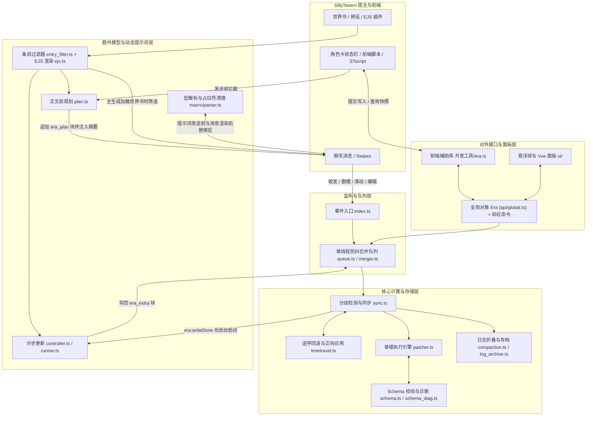
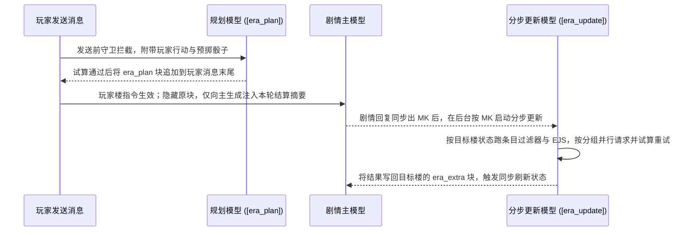

# ERA-Heron 架构与原理说明

本文面向希望了解 ERA-Heron 内部实现、排查复杂问题或参与二次开发的读者。如果你是要制作角色卡，请直接阅读面向作者的使用文档 [`doc/01-快速上手.md`](./01-快速上手.md) 至 [`doc/08-动态提示词.md`](./08-动态提示词.md)；参与本仓库开发前的协作规范见 [`AGENTS.md`](../AGENTS.md)。

> 当前对应版本：**ERA-Heron 2.0.4**（基于 ERA 变量框架，原作者 世界的山田 / RockingSisyphus，二次开发、持续迭代作者 白鹭辞 / Bailuci）。改动历史见 [`更新日志.md`](../更新日志.md)。

## 目录

- [一、核心模型与设计约束](#一核心模型与设计约束)
- [二、整体架构与源码目录](#二整体架构与源码目录)
- [三、核心引擎运转机制](#三核心引擎运转机制)
- [四、已实现的功能模块](#四已实现的功能模块)

---

## 一、核心模型与设计约束

**ERA-Heron** 是运行在 SillyTavern「酒馆助手（Tavern Helper）」上的变量框架。它解析 AI 回复与脚本提交的变量操作，维护当前聊天的状态对象 `stat_data`，并在玩家删除、滑动（swipe）、编辑消息或切换分支时，将变量回滚并重算到与当前可见聊天记录一致的状态。

### 记账本式的状态管理

与“每一楼都单独保存一份完整变量快照”的做法不同，ERA-Heron 在聊天变量（`{ type: 'chat' }`）里只保存**一份当前最新状态 `stat_data`**，以及存放在 `ERAMetaData` 中的元数据（定义见 [`utils/constants.ts`](../src/ERA变量框架/utils/constants.ts)）：

1. **消息正文是事实来源**：AI 写在消息里的指令块，加上挂在对应楼层上的旁路写入 `ApiOps`（[`core/api_ops.ts`](../src/ERA变量框架/core/api_ops.ts)），是重建全部变量的唯一起点。
2. **楼层锚点链 `SelectedMks`**：ERA 会为每条消息（含同一楼的不同 swipe）分配唯一的消息密钥（MK），记在正文末尾的 `<era_data>` 标签里（[`core/key/mk.ts`](../src/ERA变量框架/core/key/mk.ts)）。`SelectedMks` 按楼层顺序记录上一次同步时各楼对应的 MK。
3. **可逆变更日志 `EditLogs`**：以 MK 为键，记录该条消息产生的所有 `insert`、`update`、`delete` 明细（包含旧值与新值）。当历史发生变化时，框架对比 `SelectedMks` 与当前消息流找到最早分歧点，按 `EditLogs` 逆序回滚到分歧点之前，再按新消息顺序重新计算。

### 三条基本设计约束

- **重算结果必须可复现**：历史楼层在删除、编辑或重算时会被再次执行。为此框架内置了跨浏览器一致的确定性数学库 [`utils/det_math.ts`](../src/ERA变量框架/utils/det_math.ts)（三角、指数、对数移植自 `fdlibm`），所有表达式与钩子/工具内的随机数均基于楼层 MK 与调用位置派生种子（[`utils/seeded_random.ts`](../src/ERA变量框架/utils/seeded_random.ts)），保证同一楼重算后的数值与骰点不变。
- **扩展逻辑必须同步且无副作用**：变量结构（schema）、更新钩子（hooks）、工具（tools）和条目过滤器（entry filter）均为同步纯函数；执行期间由 [`core/reentry.ts`](../src/ERA变量框架/core/reentry.ts) 开启重入保护，拦截在回调中再次调用写入接口的行为，防止循环触发重算。
- **不在 `GENERATION_STARTED` 中暂停生成**：酒馆触发 `GENERATION_STARTED` 时界面尚未锁定，在此处等待容易造成重复生成或串聊天。需要等待后台更新完成或执行正文前规划时，统一在玩家点击发送或按回车前通过 [`extra/send_guard.ts`](../src/ERA变量框架/extra/send_guard.ts) 拦截。

---

## 二、整体架构与源码目录

### 源码目录索引

| 目录 / 文件 | 职责说明 | 主要源码文件 |
| :--- | :--- | :--- |
| 入口模块 | 注册酒馆事件、脚本按钮和版本检查，将外部事件统一推入队列 | [`src/ERA变量框架/index.ts`](../src/ERA变量框架/index.ts) |
| `events/` | 单线程队列锁、防抖收集窗口、同组事件合并、组合事件识别、等待凭据（Ticket）管理 | [`queue.ts`](../src/ERA变量框架/events/queue.ts)、[`merger.ts`](../src/ERA变量框架/events/merger.ts)、[`dispatcher.ts`](../src/ERA变量框架/events/dispatcher.ts)、[`tickets.ts`](../src/ERA变量框架/events/handlers/api/tickets.ts) |
| `core/` | MK 管理、历史分歧检测与回滚同步、单楼执行与指令 CRUD、`$expr` 求值、工具执行、schema 校验与诊断、日志折叠与归档压缩 | [`sync.ts`](../src/ERA变量框架/core/sync.ts)、[`timetravel.ts`](../src/ERA变量框架/core/timetravel.ts)、[`patcher.ts`](../src/ERA变量框架/core/crud/patcher.ts)、[`expr.ts`](../src/ERA变量框架/core/crud/expr.ts)、[`patch.ts`](../src/ERA变量框架/core/crud/patch.ts)、[`tools.ts`](../src/ERA变量框架/core/tools.ts)、[`schema.ts`](../src/ERA变量框架/core/schema.ts)、[`schema_diag.ts`](../src/ERA变量框架/core/schema_diag.ts)、[`log_archive.ts`](../src/ERA变量框架/core/log_archive.ts) |
| `extra/` | 后台分步更新、正文前规划、目标楼 EJS 沙箱渲染、动态条目过滤器、分阶段预设与请求组装、发送前守卫 | [`controller.ts`](../src/ERA变量框架/extra/controller.ts)、[`runner.ts`](../src/ERA变量框架/extra/runner.ts)、[`prompt.ts`](../src/ERA变量框架/extra/prompt.ts)、[`request.ts`](../src/ERA变量框架/extra/request.ts)、[`plan.ts`](../src/ERA变量框架/extra/plan.ts)、[`ejs.ts`](../src/ERA变量框架/extra/ejs.ts)、[`entry_filter.ts`](../src/ERA变量框架/extra/entry_filter.ts)、[`send_guard.ts`](../src/ERA变量框架/extra/send_guard.ts) |
| `macro/` | 在提示词发送前和消息渲染后展开 ERA 宏，从发送给剧情模型的历史中剥离 `<era_extra>`、`<era_plan>` 与状态栏占位符 | [`parser.ts`](../src/ERA变量框架/macro/parser.ts)、[`parse.ts`](../src/ERA变量框架/macro/parse.ts) |
| `api/` 与 `开发工具/` | 通过 `initializeGlobal('Era', ...)` 共享全局接口、维护按角色卡隔离的注册表，并提供前端 Pinia Store 封装与类型声明 | [`global.ts`](../src/ERA变量框架/api/global.ts)、[`schema_registry.ts`](../src/ERA变量框架/api/schema_registry.ts)、[`tool_registry.ts`](../src/ERA变量框架/api/tool_registry.ts)、[`开发工具/era.ts`](../开发工具/era.ts)、[`开发工具/exported.era.d.ts`](../开发工具/exported.era.d.ts) |
| `initer/` | 快速初始化写入的世界书规则条目与正则，以及旧卡规则无损升级逻辑 | [`worldbook.ts`](../src/ERA变量框架/initer/manual/worldbook.ts)、[`regex.ts`](../src/ERA变量框架/initer/manual/regex.ts)、[`update.ts`](../src/ERA变量框架/initer/manual/update.ts) |
| `ui/` | Vue 3 悬浮球与面板、标签页注册表、工作台试算、schema 一键修复、聊天数据体积统计与斜杠命令 | [`EraPanel.vue`](../src/ERA变量框架/ui/components/EraPanel.vue)、[`tabs/index.ts`](../src/ERA变量框架/ui/components/tabs/index.ts)、[`schema_fix.ts`](../src/ERA变量框架/ui/schema_fix.ts)、[`size_diag.ts`](../src/ERA变量框架/ui/size_diag.ts)、[`commands.ts`](../src/ERA变量框架/ui/commands.ts) |

---

## 三、核心引擎运转机制

### 1. 事件防抖与合并队列

酒馆在滑动回复、重新生成、切换聊天等操作期间会在短时间内连续触发多个事件。为避免并发交错覆盖状态：

- **串行执行**：[`events/queue.ts`](../src/ERA变量框架/events/queue.ts) 使用处理器锁保证同一时刻只有一个批次在执行。每个任务外包独立异常捕获，单个任务失败只拒绝它自己的等待凭据，不会阻塞后续事件。
- **窗口收集与合并**：[`events/merger.ts`](../src/ERA变量框架/events/merger.ts) 对非 API 事件开启短暂防抖窗口，将连续到达的同组 `SYNC` 事件合并，同时继承被合并事件携带的“强制完全重算”和“清理孤儿旁路写入”标记；当 `MESSAGE_SWIPED` 紧接 `GENERATION_STARTED` 或 `MESSAGE_UPDATED` 紧接 `GENERATION_STARTED` 时，合成为定向组合事件并立即结束等待。

### 2. 分歧检测与时空回滚

[`core/sync.ts`](../src/ERA变量框架/core/sync.ts) 里的 `resyncStateOnHistoryChange` 负责把聊天变量与当前消息流对齐：

- **重复 MK 修复**：如果用户复制过消息导致多楼拥有相同 MK，同步开始前先调用 `dedupeMessageKeys` 重新分配 MK，避免日志互相覆盖。
- **查找分歧点**：`findDivergencePoint` 比对当前各楼 MK 列表与 `SelectedMks`：
  - 若仅删除了不含任何变量变动的楼层且没有待执行的旁路写入，则走快速同步（`FAST_SYNC`），只更新 `SelectedMks`；
  - 其余情况定位最早分歧楼层（若存在新注册的钩子、工具或版本升级，按需扩大重算起点），先在内存中用 [`core/timetravel.ts`](../src/ERA变量框架/core/timetravel.ts) 的 `rollbackStatToMK` 逆序回滚到分歧点前，再逐楼重算并一次性写回。
- **防跨聊天污染**：同步开始时记录 `chatId`，异步步骤返回后若检测到当前聊天已切换，立即放弃本次写入（返回 `aborted`）。

### 3. 单楼执行流水线

对单条消息的计算集中在纯函数 `ApplyVarChangeForMessage`（[`core/crud/patcher.ts`](../src/ERA变量框架/core/crud/patcher.ts)），不直接读写全局状态，顺序如下：

1. **指令解析与交错编排**：按当前聊天的解析版本（[`core/version.ts`](../src/ERA变量框架/core/version.ts)）从正文提取指令块，再通过 `interleaveApiOps` 将挂在该楼的旁路写入 `ApiOps` 按写入时的块位置交错合并。
2. **前置钩子 `onBeforeApply`**：仅对非用户消息执行，可读取本楼初值并修改、增删指令列表。
3. **按顺序执行指令块与工具调用**：
   - 依次执行 `insert`、`edit`、`delete`、`patch`；
   - 遇到 `<EraFCall>` 时，[`core/tools.ts`](../src/ERA变量框架/core/tools.ts) 传入执行到当前位置的中间状态运行工具 `handler`，并将产出的普通操作紧接着就地执行；
   - 若注册了 schema，每执行完一个指令块即调用 `applySchemaToBlock`（[`core/schema.ts`](../src/ERA变量框架/core/schema.ts)）：合法时写回类型转换与钳制结果；整块不合法但块前合法时，通过多趟逐条重放（`<VariablePatch>` 按操作重放）保留合法项、丢弃违例项，支持同块内跨字段约束协同生效。
4. **整楼默认值补全**：整条消息的指令全部跑完后执行 `normalizeStat`，避免默认值在块间提前占位导致后续 `<VariableInsert>` 因路径已存在而失效。
5. **后置钩子 `onAfterApply`**：在非空状态上计算派生数值，钩子产生的变更同样过 schema 校验并记入日志。
6. **汇总返回**：输出本楼 `finalStat`、`finalEditLog`、`commandIssues`、`schemaRejections` 与 `toolResults`。

### 4. 日志折叠与分段文件存档

当聊天楼层较长时，可通过脚本设置控制元数据体积：

- **日志折叠**（[`core/compaction.ts`](../src/ERA变量框架/core/compaction.ts)）：配置 `日志保留楼层数` 后，早于保留窗口的逐楼 `EditLogs` 会合并为折叠边界楼的一份等效日志，缩短聊天 JSON 体积。
- **分段文件存档**（[`core/log_archive.ts`](../src/ERA变量框架/core/log_archive.ts)、[`core/log_compress.ts`](../src/ERA变量框架/core/log_compress.ts)）：同时开启 `折叠日志存档` 后，每攒够 10 楼（`ARCHIVE_BATCH`）即将被折叠的逐楼日志会先做单楼压缩与回放自检，再上传为酒馆 `user/files/era_logs_*.json` 独立文件，聊天元数据只保留路径、范围和哈希校验值。存档视为可重建缓存：查询或回滚旧楼时按需拉取并校验，文件缺失或校验不符时自动退回从第 0 楼按正文重放。

---

## 四、已实现的功能模块

### 1. 变量指令与公式计算

- **核心指令标签**（使用说明见 [`doc/02-指令手册.md`](./02-指令手册.md)）：
  - `<VariableInsert>`：仅插入不存在的字段；支持 `$template` 补齐默认子字段，以及 `$meta`（`updatable`、`necessary`、`unInsertAble`）节点保护。
  - `<VariableEdit>`：修改已存在字段；支持数字增量（`+=`、`-=`、`*=`、`/=`）以及 `{"$expr": "..."}` 表达式求值。
  - `<VariableDelete>`：删除对象键或子树。
  - `<VariablePatch>`（[`core/crud/patch.ts`](../src/ERA变量框架/core/crud/patch.ts)）：路径式数组操作列表，支持核心操作 `replace`、`insert`、`append`、`delta`、`toggle`、`remove`、`move`、`copy` 及常见兼容别名（如 `set`/`update`、`add`、`inc`/`increment`、`delete`/`unset`、`rename`），适合数组尾部追加（`/背包/-`）、有则改无则建和字段移动。
  - `<EraFCall name="工具名">参数</EraFCall>`（[`core/tools.ts`](../src/ERA变量框架/core/tools.ts)）：按位置调用角色卡脚本注册的同步工具函数，读取实时中间状态并产出普通变量操作；工具在历史中缺失时记录到 `ERAMetaData.Extensions`，待工具注册或 `version` 变更时自动触发完全重算。
- **`$expr` 表达式引擎**（[`core/crud/expr.ts`](../src/ERA变量框架/core/crud/expr.ts)）：
  - 手写词法与递归下降解析器，不使用 `eval` / `new Function`，支持全角符号归一化与面向 AI 的中文错误提示。
  - 支持四则运算、乘方 `^`、当前路径与 `@路径`（读本楼开始前的旧值）、常量 `PI`/`E`、内置基础与初等数学函数、可重放随机函数 `roll` / `random` / `random_at`（完整函数表见 [`core/crud/expr.ts`](../src/ERA变量框架/core/crud/expr.ts) 中的 `BUILTINS`），以及通过 `Era.registerExprFn` 注册的自定义公式函数。
  - 支持 `call(公式路径, 参数…)`：作者把公式文本存成普通字符串变量（例如 `"公式": { "伤害": "max(1, a * 2 - b)" }`），AI 在 `$expr` 里直接传参调用（公式内用单独小写字母 `a`、`b`、`c`…… 依次引用参数），无需写脚本即可复用计算公式。
- **解析容错与范围隔离**：
  - `宽松解析`（[`utils/tolerant_json.ts`](../src/ERA变量框架/utils/tolerant_json.ts)）：自动修复尾随逗号、单引号、未加引号键名等常见不规范 JSON。
  - `下划线只读`：开启后限制 AI 修改或删除以 `_` 开头的字段（旁路 API 写入、钩子和工具不受限）。
  - 解析版本标记（`ParserVersion`）：新建聊天默认忽略 `思考标签`（默认 `think, thinking`）内的草稿指令，且可配置 `指令外层标签` 仅识别指定标签内的指令，同时保持旧聊天的原有重算语义不变。

### 2. 变量结构（Zod Schema）校验、诊断与一键修复

- **运行期校验与纠正**（[`core/schema.ts`](../src/ERA变量框架/core/schema.ts)）：角色卡注册任意带 `safeParse` 的对象（如 Zod schema）后，合法变更中的 `transform` / `coerce` / `prefault` 纠正会转为 `EditLog` 落盘，违例修改被丢弃并广播 `era:schemaError`。
- **老存档放行与自动诊断**（[`core/schema_diag.ts`](../src/ERA变量框架/core/schema_diag.ts)）：当修改前的状态本就不合法（`pre_invalid`，常见于作者升级 schema 新增必填字段）时，框架放行修改而不锁死存档，并在同步完成后校验最新状态，将问题分为缺必填字段（`missing`）与类型/取值不符（`invalid`），按聊天和问题签名去重广播 `era:schemaInvalid`。
- **黑盒推导与一键修复**（[`ui/schema_fix.ts`](../src/ERA变量框架/ui/schema_fix.ts)）：面对外部脚本创建的黑盒 schema，通过逐项试探推导修复方案（无损类型强转、删除非法叶子让 `default`/`prefault` 接管、缺失字段试补空对象/空数组、逐级删除父节点、剩余无默认值必填项由玩家手填），用目标楼试算器确认修复后合法，写入前核对楼层身份锚点，再以 `Era.commit(..., { atomic: true })` 写入最新 AI 楼并支持撤销本次修复。

### 3. 正文前规划与后台分步更新

ERA-Heron 支持将检定、剧情写作和变量结算拆分为独立请求（使用说明见 [`doc/06-分步更新.md`](./06-分步更新.md)）：

- **正文前规划**（[`extra/plan.ts`](../src/ERA变量框架/extra/plan.ts)）：玩家点击发送时，若开启规划且世界书存在 `[era_plan]` 条目，规划模型借助 ERA 预先掷好的骰子（`rollPlanDice`）先结算本轮检定与消耗，产出 `<PlanSummary>` 摘要和普通变量指令并包进 `<era_plan>` 追加到**玩家消息**末尾。由于锚定在玩家楼，之后滑动或重生成 AI 回复时规划结果与骰点自动复用；发送给剧情模型前隐藏 `<era_plan>` 并注入 `<本轮结算>` 摘要。
- **后台分步更新**（[`extra/controller.ts`](../src/ERA变量框架/extra/controller.ts)、[`extra/runner.ts`](../src/ERA变量框架/extra/runner.ts)）：
  - 主生成不加载纯 `[era_update]` 条目；回复完成并触发 `era:writeDone` 后（若主回复自身尚未包含指令块），按消息 `MK` 在后台启动更新任务，支持按 `[era_update:组名]` 多分组并行请求。
  - 返回的指令会经 `createExtraSimulator`（[`core/simulate.ts`](../src/ERA变量框架/core/simulate.ts)）在目标楼上真实试算，出现语法截断、路径无效或 schema 拦截时把具体错误拼入对话历史让模型修正；支持主备 API 自动故障转移和按状态码区分的可重试指数退避。
  - 若开启“发送前等待”，玩家发送下一条消息时由 `send_guard` 等待未完成的更新与待同步写入（可点击提示取消等待）。
- **请求组装与历史记录**（[`extra/request.ts`](../src/ERA变量框架/extra/request.ts)）：
  - 更新模型与规划模型可各自配置酒馆预设（不使用、使用当前预设或使用指定预设，更新模型支持按分组指定），读取预设中“聊天记录”前后的非占位启用条目（保留各自角色）与采样参数，叠加玩家本机的头部提示词、可选的角色描述/用户人设以及流式/非流式开关；
  - 面板支持将可推荐项“存为本卡推荐”（写入角色卡变量 `ERA分步更新`）；
  - `Era.extra.status().history` 在内存中保留最近 10 次分步更新与规划的完整请求记录（类型、楼层、状态、实际发送的提示词、原始回复、问题与告警），切换聊天时清空。

### 4. 动态提示词：宏、目标楼 EJS 与条目过滤器

- **内置宏**（[`macro/parse.ts`](../src/ERA变量框架/macro/parse.ts)、[`macro/parser.ts`](../src/ERA变量框架/macro/parser.ts)，详见 [`doc/04-宏.md`](./04-宏.md)）：
  - 变量读取：`{{ERA:路径}}`（含 `{{ERA:$ALLDATA}}`，自动去掉 `$` 开头内部字段）与 `{{ERA-withmeta:路径}}`；
  - 自描述与自纠：`{{ERA-schema}}`（由已注册 schema 生成结构说明）、`{{ERA-issues}}`（仅在主生成提示词中展开上一条 AI 回复未生效的主模型指令原因）；
  - 扩展信息：`{{ERA-tools}}`、`{{ERA-exprFns}}`、`{{ERA-toolResults}}`。
  - 在 `GENERATE_AFTER_DATA` 阶段，若事件队列仍有同步未完成，最多等待 `PROMPT_SYNC_WAIT` 后再替换提示词中的宏，同时从历史消息中剥离 `<era_extra>`、`<era_plan>` 和状态栏占位符。
- **目标楼 EJS 沙箱**（[`extra/ejs.ts`](../src/ERA变量框架/extra/ejs.ts)）：
  - 分步更新与规划在“EJS 预处理”开启且检测到提示词模板插件（`EjsTemplate`）启用时，借用 `prepareContext` / `evalTemplate` 渲染条目中的 `<% ... %>` 与 `@@if` 装饰器；
  - 重写 `variables.stat_data` 以及 `getvar` / `getLocalVar` / `getGlobalVar` / `getMessageVar`，让 `stat_data` 路径一律读取**被解析那一楼的状态**；
  - 将 `setvar`、`incvar`、`decvar`、`delvar`、`insvar`、`patchVariables`、`setVariableSchema`、`activewi`、`activateWorldInfo`、`injectPrompt`、`activateRegex`、`execute` 等写入与副作用函数全部替换为空操作并记入 `warnings`（完整列表见 [`extra/ejs.ts`](../src/ERA变量框架/extra/ejs.ts) 的 `WRITE_FUNCTIONS`），避免 `[era_both]` 条目在主生成与分步更新中产生重复副作用。
- **动态世界书条目过滤器**（[`extra/entry_filter.ts`](../src/ERA变量框架/extra/entry_filter.ts)，详见 [`doc/08-动态提示词.md`](./08-动态提示词.md)）：
  - 通过 `Era.registerEntryFilter` 注册同步纯函数，在主生成（`purpose: 'main'`，按最新状态，仅在非 dry-run 的真实主生成期间运行）、正文前规划（`purpose: 'plan'`）和分步更新（`purpose: 'extra'`，按目标楼状态）加载世界书时，按变量决定条目排除、强制纳入或替换内容，不改写磁盘上的世界书文件；主生成中对带粘性（sticky）或冷却（cooldown）的条目仅允许排除，避免打乱酒馆计时。

### 5. 对外接口、前端辅助库与斜杠命令

- **全局对象 `Era`**（实现见 [`api/global.ts`](../src/ERA变量框架/api/global.ts)，完整类型见 [`开发工具/exported.era.d.ts`](../开发工具/exported.era.d.ts)，使用说明见 [`doc/05-接口与设置.md`](./05-接口与设置.md)）：
  - 版本与能力探测：`Era.version`、`Era.features`（角色卡还可通过角色卡变量 `ERA最低版本` 或 `requireEra('2.0.2')` 声明最低版本）。
  - 读取与诊断：`Era.getCurrentVars()`、`Era.getVarsAt(where)`、`Era.checkSchema(mk?)`、`Era.describeSchema()`、`Era.math`。
  - 写入与正文操作：`Era.commit(operations, { mk, message_id, atomic, key })`（旁路写入、支持原子提交与幂等键 `key`）、`Era.applyText(text, options)`、`Era.parseCommands(text)`、`Era.simulate(text, mk?, { seedMk })`、`Era.keepMessageKey(text, from)`、`Era.setMessageText(where, text)`（改写一楼正文，自动保留 `<era_data>` 与 `<era_extra>` 并触发重算后返回结果）。
  - 扩展注册：`Era.registerSchema` / `unregisterSchema` / `hasSchema`、`Era.onBeforeApply` / `onAfterApply` / `hasHook`、`Era.registerEntryFilter` / `hasEntryFilter`、`Era.registerTool` / `hasTool`、`Era.registerExprFn` / `hasExprFn`。所有注册项均绑定到注册时的角色卡或群聊（`getCurrentOwner`），切卡时自动失效。
  - 额外模型与规划控制：`Era.extra.{run, abort, wait, status, plan, replan}`。
- **前端辅助库**（[`开发工具/era.ts`](../开发工具/era.ts)）：
  - 为 Vue + Pinia 状态栏和常驻界面提供 `defineEraDataStore`（最新变量）、`defineEraFloorStore`（按 `message_id` 定格某一楼的历史变量）、`isLatestFloor`、`requireEra`、`compareEraVersions`、`getEraMath`，以及在 ERA 脚本重载后自动补注册的 `registerEraSchema`、`registerEraHook`、`registerEraEntryFilter`、`registerEraTool`、`registerEraExprFn`。
- **STscript 斜杠命令**（[`ui/commands.ts`](../src/ERA变量框架/ui/commands.ts) 与面板命令）：
  - `/era`、`/era ball`、`/era hide`：打开面板与控制悬浮球显隐；
  - `/era-get [meta=true] 路径`：同步等待队列空闲后返回去转义变量的 JSON；
  - `/era-issues [format=text|json|model]`：查看最新 AI 楼未生效的指令与原因。

### 6. 悬浮球与可视化工作台

界面层位于 [`src/ERA变量框架/ui/`](../src/ERA变量框架/ui/)，提供可拖拽、贴边停靠、支持夜间模式和手机端全屏的悬浮球，点击后打开基于标签页注册表（[`ui/components/tabs/index.ts`](../src/ERA变量框架/ui/components/tabs/index.ts)）渲染的面板：

- **变量**：树形查看与搜索当前 `stat_data`，修改后先通过楼层试算预览效果再原子提交。
- **日志**：逐楼查看 `EditLogs` 明细与折叠归档状态。
- **快照**：查看历史各楼当时的变量状态并支持回退。
- **分步更新**：配置分步更新与正文前规划、主备 API、分阶段预设、存为本卡推荐、手动重解析/重规划以及查看最近请求记录。
- **工具**：提供“ERA 快速初始化”（写入世界书规则条目、意图说明骨架以及隐藏与状态栏正则，详见 [`initer/manual/`](../src/ERA变量框架/initer/manual/)）和“更新旧卡的规则”（备份旧内容后将规则条目与隐藏正则升级到新版，不覆盖作者自写的意图说明与状态栏 HTML），以及强制重算等维护按钮。
- **诊断**：提供变量结构诊断与一键修复（[`ui/schema_fix.ts`](../src/ERA变量框架/ui/schema_fix.ts)），以及聊天数据体积统计（[`ui/size_diag.ts`](../src/ERA变量框架/ui/size_diag.ts)，统计 `stat_data`、`EditLogs`、`ApiOps`、正文大小与当前挂载的状态栏 iframe 数）。
- **设置**：管理全部脚本设置（定义与默认值见 [`utils/constants.ts`](../src/ERA变量框架/utils/constants.ts) 的 `SETTING_FIELDS`，读取时逐字段容错，保存前严格校验并保留未知的高版本字段）。
- **关于**：显示版本号、作者与原作者信息、文档快捷入口、面板打开方式、当前 schema 注册状态与 AFPL 许可说明。
